

#  Brisola Mecânica Automotiva 

> Visite o site: [Brisola Mecânica Automotiva - Landing Page](https://brisola-mecanica.vercel.app)

 

## Sobre o projeto

Landing page criada para a Brisola Mecânica Automotiva, oficina mecânica premium em Sorocaba/SP desde 2016.

A página reúne num só lugar tudo o que o cliente precisa para confiar e agendar: como a oficina trabalha, os 15 serviços (cada um com a sua página), as etapas do atendimento, as avaliações do Google e o caminho até lá. Todos os caminhos levam ao WhatsApp, com a mensagem de agendamento já escrita.

O visual nasceu de uma ideia: a estrada noturna que leva até a oficina. O preto do asfalto, o amarelo da marca nas faixas e nos faróis e a bandeira quadriculada de chegada.

 

## Prévia

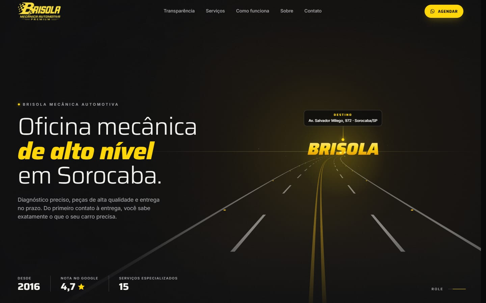

<table>
  <tr>
    <td width="50%">
      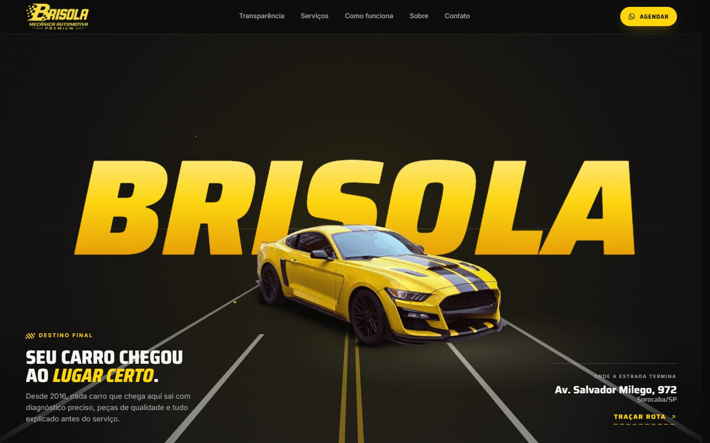
      
<b>Destino final</b> Rolando a página, a câmera dirige pela estrada até a oficina

    </td>
    <td width="50%">
      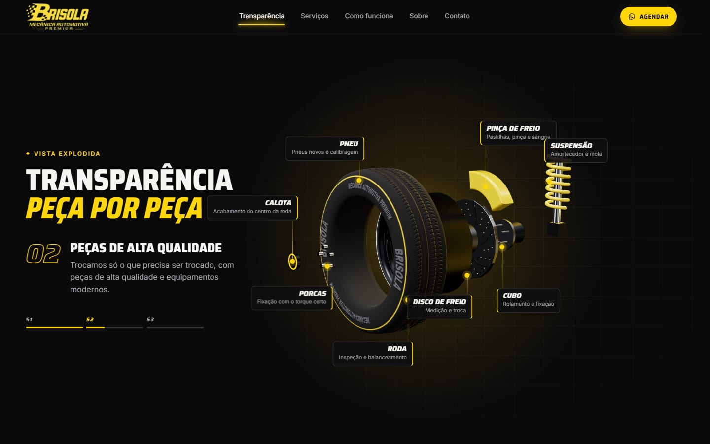
      
<b>Vista explodida</b> A roda 3D se desmonta com a rolagem e mostra cada peça

    </td>
  </tr>
  <tr>
    <td width="50%">
      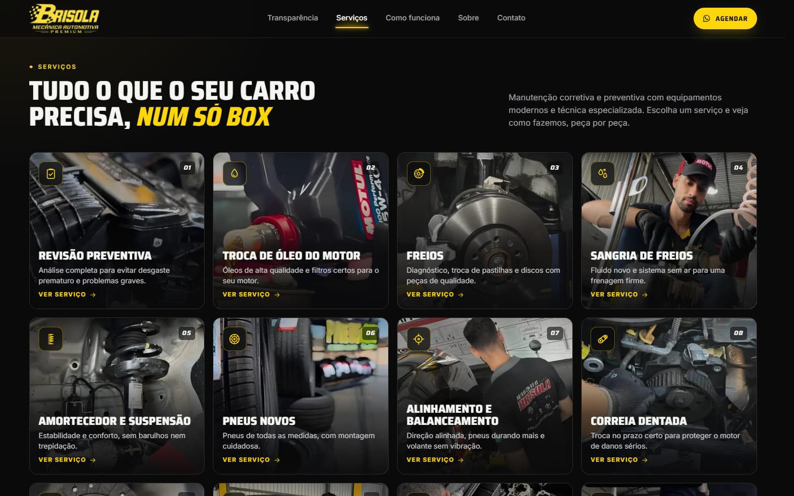
      
<b>Serviços</b> 15 serviços com fotos reais e uma página para cada um

    </td>
    <td width="50%">
      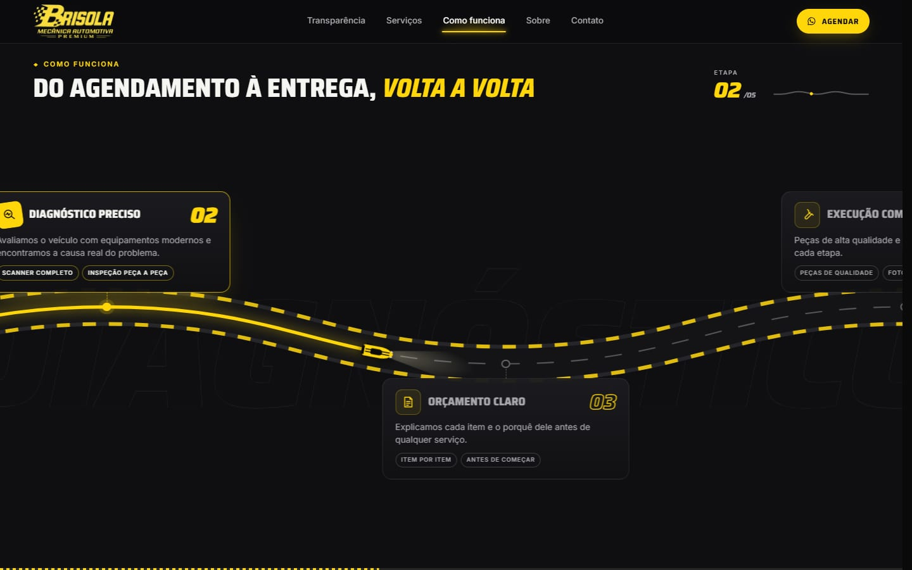
      
<b>Como funciona</b> Um carrinho percorre a pista e acende cada etapa

    </td>
  </tr>
  <tr>
    <td width="50%">
      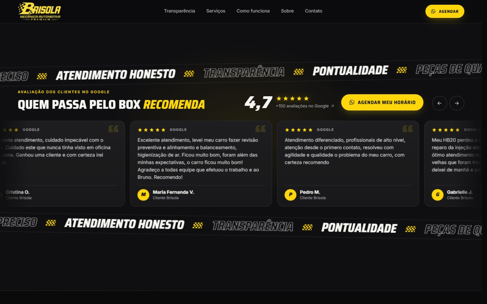
      
<b>Avaliações</b> Nota 4,7 e comentários reais do Google

    </td>
    <td width="50%">
      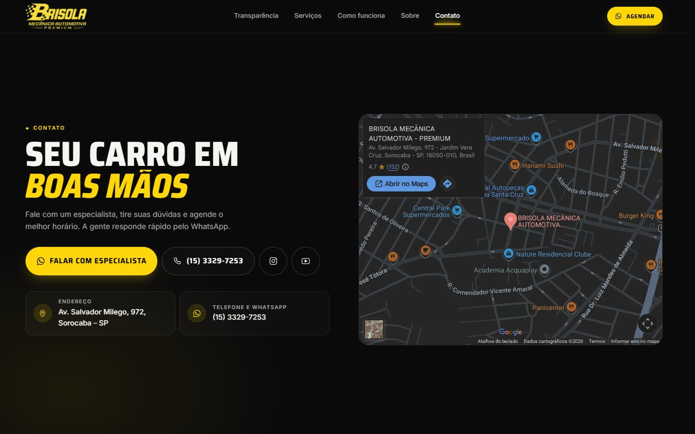
      
<b>Contato</b> WhatsApp, telefone, redes e o mapa até a oficina

    </td>
  </tr>
  <tr>
    <td width="50%">
      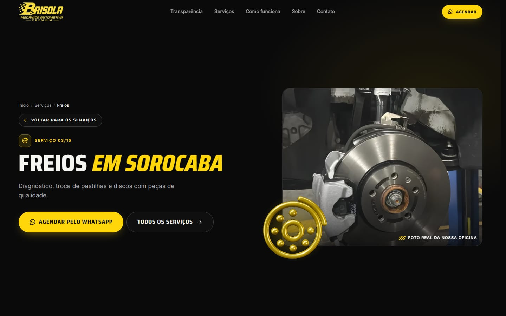
      
<b>Página de serviço</b> Detalhes, quando fazer, benefícios e o passo a passo

    </td>
    <td width="50%">
      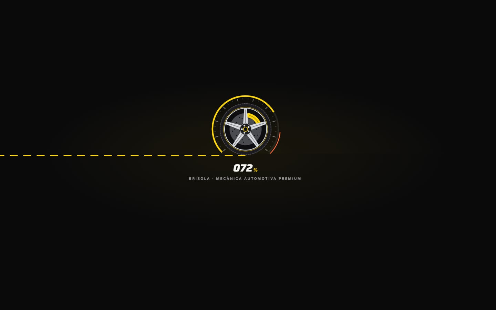
      
<b>Abertura animada</b> A roda entra rolando, o conta-giros acompanha o carregamento e a cortina se abre

    </td>
  </tr>
</table>

### No celular

A maioria de quem procura oficina está no celular, vindo do Google ou do Instagram, então cada cena foi pensada também para a tela pequena: a estrada ocupa a tela inteira, as peças da roda ganham etiquetas compactas e a pista do “Como funciona” também anda com o arraste para o lado.

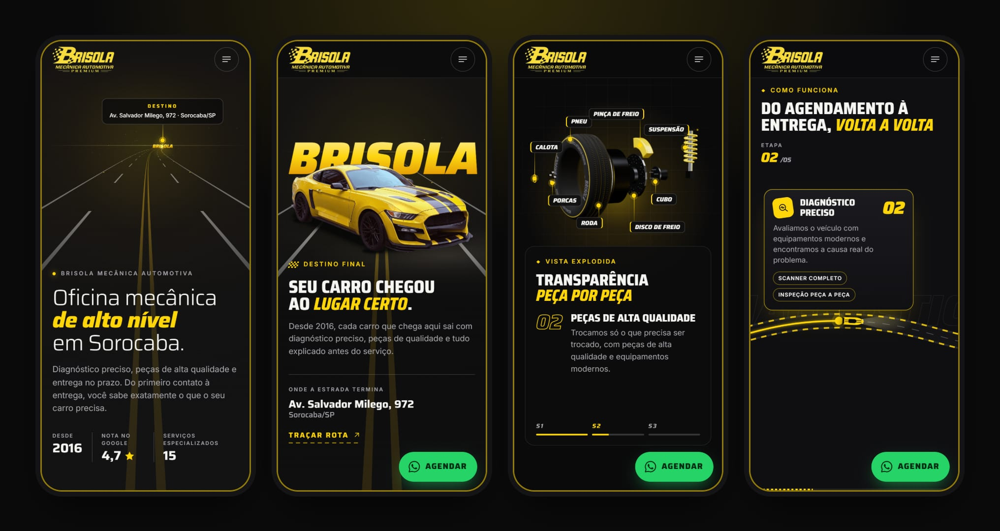

 

## Destaques

- **Agendamento em um toque**: todos os botões abrem o WhatsApp com a mensagem pronta (com o nome do serviço, nas páginas de serviço), e um botão flutuante acompanha a rolagem.
- **Viagem pela estrada**: o topo é uma estrada noturna desenhada ao vivo. Rolando, a câmera dirige até o nome da oficina, aceso como uma placa, com o carro estacionado na frente.
- **Vista explodida em 3D**: uma roda feita em Three.js (pneu, roda, disco, pinça, cubo e suspensão) se desmonta com a rolagem, passa por um scanner e mostra o nome de cada peça.
- **Como funciona**: uma pista de corrida em que um carrinho percorre as cinco etapas do atendimento, guiado pela rolagem.
- **15 páginas de serviço**: cada uma com texto próprio, foto real da oficina, o ícone do serviço transformado em escultura 3D e o passo a passo em formato de estrada.
- **Abertura animada**: a roda entra rolando e pintando a faixa da estrada, o conta-giros acompanha o carregamento real e a cortina se abre para a página.
- **Animações que contam a história**: títulos revelados linha a linha, contadores, faixas guiadas pela rolagem, carrossel de avaliações que pode ser arrastado e microinterações em botões, cards e ícones.
- **Mesma proporção em qualquer tela**: o layout escala a partir do notebook de referência, sem rolagem lateral, do celular aos monitores grandes.
- **Acessível**: respeita a preferência "reduzir movimento" do sistema, tem navegação por teclado, foco visível e textos alternativos nas fotos.
- **Pronta para o Google**: metadados e prévia para compartilhamento em todas as páginas, sitemap, robots, dados estruturados (oficina, serviços e trilha de navegação) e os endereços do site antigo redirecionados.
- **Rápida**: páginas estáticas, fotos otimizadas automaticamente (AVIF/WebP), fontes servidas pelo próprio site e o 3D e as bibliotecas de animação carregados só depois que a página aparece.
- **Segura**: cabeçalhos de segurança (HSTS, proteção contra clickjacking e política de permissões) e página de política de privacidade.

 

## Identidade visual

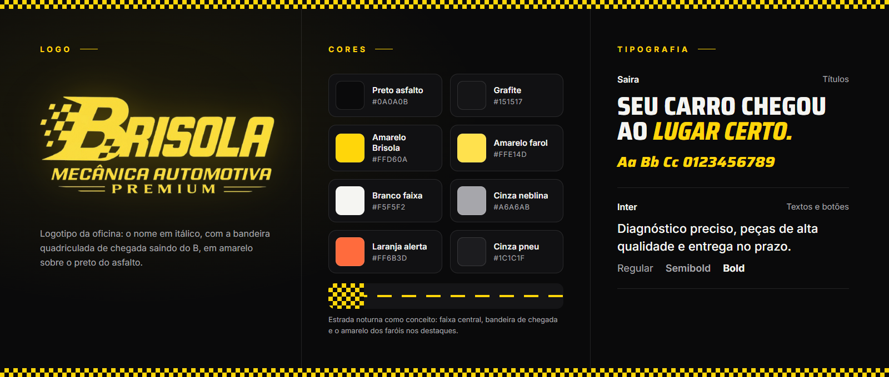

- **Logo**: o nome Brisola em itálico, com a bandeira quadriculada de chegada saindo do B, em amarelo sobre o preto. Aparece no topo, na abertura e como ícone do site.
- **Cores**: preto do asfalto e grafite no fundo, o amarelo Brisola nos destaques (faixas, faróis e botões), branco nos textos e o laranja de alerta em detalhes, como o limite do conta-giros.
- **Tipografia**: Saira nos títulos, condensada e com itálico nos destaques, no espírito dos letreiros de corrida; Inter nos textos e botões.

 

## Tecnologias

      

| Camada | Escolha |
| --- | --- |
| Framework | Next.js 16 (App Router), com as páginas geradas de forma estática |
| Interface | React 19 + TypeScript |
| Estilos | CSS Modules, sem frameworks de CSS |
| Animações | GSAP (ScrollTrigger e SplitText), rolagem suave com Lenis e Canvas 2D |
| 3D | Three.js com React Three Fiber |
| Imagens e fontes | `next/image` e `next/font` |
| Hospedagem | Vercel |

 

## Código-fonte

> [!NOTE]
> O código-fonte deste projeto é **privado**. Este repositório serve apenas como apresentação do trabalho.

 

## Direitos

Fotos, textos, nome e marca pertencem à **Brisola Mecânica Automotiva**. Todos os direitos reservados: não é permitido reproduzir ou reutilizar este conteúdo sem autorização.

Exceção: a foto do Ford Mustang Shelby GT500 da seção Destino final é de [Vincent van Zeijst](https://commons.wikimedia.org/wiki/File:Ford_Mustang_Shelby_GT500_(1).jpg), sob a licença [CC BY-SA 4.0](https://creativecommons.org/licenses/by-sa/4.0/deed.pt-br) (placa e adesivo removidos, fundo recortado).

<!-- Desenvolvido por: Guilherme Francisco Pereira-->
